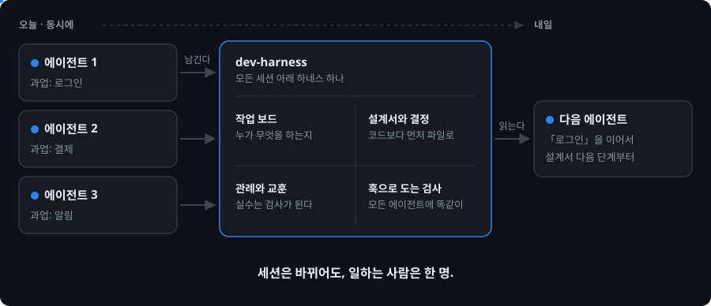
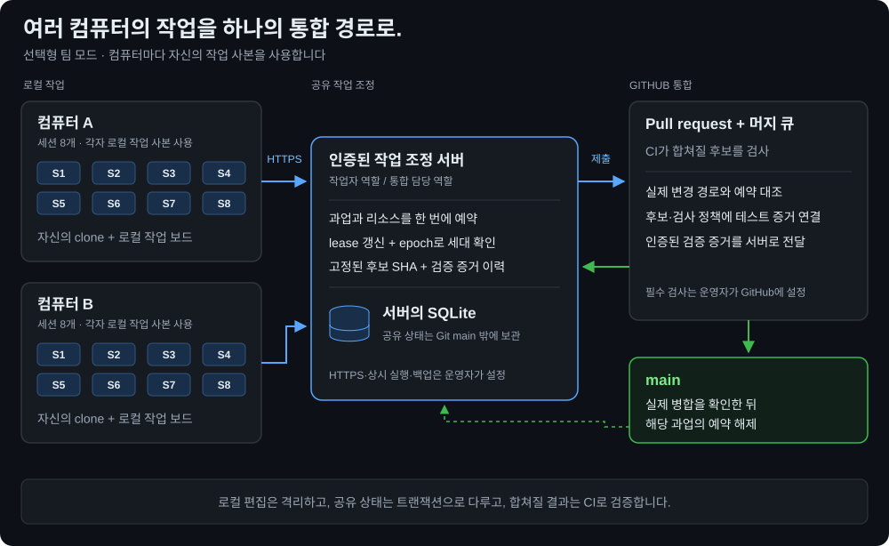

<div align="center">

# agent-harness

**어느 세션이 이어받아도, 한 사람이 일한 것처럼.**

설계서(plan)·결정·관례·교훈이 레포에 남고 훅이 모든 세션을 그 위에서 일하게 합니다.
어느 에이전트든, 오늘 세션이든 다음 달 세션이든.

AI 개발 하네스 v1.3.0 · 코딩 에이전트용

[English](README.md) · [한국어](README.ko.md)



</div>

## 세션이 바뀌어도 이어지는 것 (템플릿)

| | 없을 때 | agent-harness 와 함께 |
|:--|:--|:--|
| 새 세션이 시작되면 | 프로젝트를 다시 설명합니다 | 열린 과업을 받고 그 설계서를 읽어 다음 단계부터 이어갑니다 |
| 어제 내린 결정 | 대화와 함께 사라집니다 | 설계서에 남습니다. 거절한 제안도 기록돼 다시 나오지 않습니다 |
| 관례 | 세션마다 새로 만듭니다 | 한 곳에 등재됩니다. 이미 있는 함수를 이름만 바꿔 다시 만들면 잡힙니다 |
| 실수 | 다음 주에 또 납니다 | 교훈으로 적히고 검사할 수 있으면 검사가 됩니다 |
| 여러 세션이 동시에 | 서로 덮어씁니다 | 과업마다 작업 사본 하나. 공유 보드에 누가 무엇을 잡았는지 보입니다 |
| 서로 다른 에이전트 | 다른 규칙을 따릅니다 | 같은 규칙을 읽고 같은 검사를 돌립니다 |
| "다 됐어요" | 말뿐입니다 | 전체 검사와 내 테스트를 통과해야 합쳐집니다 |

## 설치

| | 템플릿 — 하네스 전체 | 플러그인 — 검사만 |
|:--|:--|:--|
| 방법 | 새 프로젝트로 clone | Claude Code 에서 명령 두 줄, 기존 레포 어디서나 |
| 열린 과업·설계서·결정·교훈을 다음 세션에 넘김 | ✓ | — |
| 저장할 때·세션 끝날 때·push 전 검사 | ✓ | ✓ |
| 셸로 소스 파일 쓰기 차단 | ✓ | ✓ |
| 코드 전에 설계: 범위 → 조사 → 설계서 → 승인 | ✓ | — |
| 과업마다 작업 사본, 공유 작업 보드, 합치기 전 제품 테스트 | ✓ | — |
| 인증된 서비스로 여러 컴퓨터의 작업 조정 | 선택 | — |
| Codex 지원 | ✓ | — |
| 업데이트 | `python -X utf8 harness_install.py --upgrade` | `/plugin update agent-harness@agent-harness` |

**템플릿.** Python 3.10 이상과 git 이 필요하고, GitHub 은 선택입니다. PowerShell·cmd·bash 어디서나 같습니다(macOS·Linux 는 `python3`).

```bash
git clone https://github.com/Gruci/agent-harness.git my-project
cd my-project
python -X utf8 harness_install.py --new
```

**플러그인.** 설정 파일과 검사 기록 몇 개만 생기고, 다른 레포는 건드리지 않습니다.

```
/plugin marketplace add Gruci/agent-harness
/plugin install agent-harness@agent-harness
```

그다음 그 폴더에서 Claude Code 를 켜고 `하네스 깔아줘` 라고 말합니다. 무엇을 만들지 묻고, 스택 고르는 것을 도운 뒤, 그 스택에 맞는 검사를 켭니다.

> **권한.** 이 폴더 안에서는 승인 프롬프트 없이 돌고, 되돌릴 수 없는 명령과 셸로 소스 파일을 쓰는 것은 훅이 막습니다. `setup_global_permissions.py` 는 **이 컴퓨터의 모든 프로젝트**에서 프롬프트를 끄니 원할 때만 실행하세요.

> **이미 코드가 있는 레포.** 먼저 `python -X utf8 harness_install.py --dry-run` 으로 현재 위반을 봅니다. 설치는 기존 위반을 보고만 하고 숨기지 않습니다. 고치거나, 알고 있는 것은 사람이 `harness_baseline.txt` 에 동결합니다.

## 첫 작업

일을 시키면 됩니다 — `로그인 기능 만들어줘`. 변경은 이렇게 흘러갑니다.

```
[질문] → [조사] → [설계서] → [승인] → [구현·검사] → [합치기 전 검사·제품 테스트] → [합치기]
                              ▲
                        직접 답하는 곳
```

- 직접 답하는 곳은 두 번입니다 — 범위 질문과 설계서 승인. 화면 작업은 시안 승인이 하나 더 있습니다.
- 작은 수정(기존 파일 3개·40줄 이하)은 설계서를 건너뜁니다. 그 한도의 80%에 이르면 저장할 때 알리고, 커진 수정은 끝낼 때 거절합니다.
- 과업마다 따로 만든 작업 사본(worktree)에서 구현합니다. 본체 폴더에는 설계서와 작업 보드만 둡니다.
- 저장할 때마다 검사가 돕니다. 작업 사본 안에서는 알리기만 하고, AI 가 합치기 전에 고칩니다.
- 같은 커밋에서 전체 검사와, 선언한 내 테스트를 통과해야 합칩니다.

## "다 됐다"가 보장하는 것과 보장하지 않는 것

| 보장하는 것 | 어떻게 |
|:--|:--|
| 검사에 실패한 채 합쳐지지 않는다 | 끝내기와 push 직전 훅이 전체 검사를 돌리고, 통과하지 않으면 거절합니다 |
| 내 테스트가 합칠 커밋에서 돌았다 | `TESTS` 에 적은 테스트를 끝낼 때와 CI 에서 돌립니다. 실행 0건이나 보고서가 없으면 실패입니다 |
| 건너뛸 수 없다고 지정한 검사가 실제로 돌았다 | `REQUIRED_CHECKS` 에 적은 검사가 안 돌면 합치지 않습니다(설정이 끝난 뒤부터) |
| 다른 세션의 작업 사본은 건드리지 않는다 | 인계받기 전에는 한 줄도 고칠 수 없습니다 |
| 실수가 규칙이 된다 | 교훈마다 검사를 적거나, 못 적는 이유를 적습니다 |

| 보장하지 않는 것 | 알아 둘 것 |
|:--|:--|
| 선언하지 않은 테스트 | `TESTS` 가 없으면 끝내기 통과는 "검사 통과"이지 "테스트 통과"가 아닙니다 |
| 손으로 친 `git push` 의 테스트 | push 직전 훅은 전체 검사만 돌립니다. 테스트는 끝낼 때와 CI 에서 돕니다 |
| 모든 `[SKIP]` | `[SKIP]` 은 통과가 아니지만, 합치기를 막는 것은 건너뛸 수 없다고 지정한 검사뿐입니다 |
| 과업 범위 밖 파일 | 끝낼 때 `[TOUCH]` 로 알리고 합칩니다. 본체 폴더의 프로파일이 `TOUCH_ENFORCE = True` 면 막습니다 |
| 과업별로 나뉜 DB·포트·캐시 | 제공하지 않습니다. 병렬 과업은 같은 자원을 씁니다 |
| 보안 경계 | 훅은 협조하는 에이전트를 규칙 위에 두는 장치이지 샌드박스가 아닙니다 |
| 업무 로직의 정확성 | 테스트가 맞는 동작을 다루는지는 여전히 리뷰 몫입니다 |

## 무엇을 잡아주나요

모든 세션이 지키는 규칙입니다. 어기면 세션이 바로 알게 되고 고칠 때까지 작업을 합칠 수 없습니다.

<p align="center"></p>
<p align="center"><sub>플러그인을 쓴 세션 기록입니다. 에이전트가 셸로 파일을 쓰려다 거절당하고, 520줄 파일을 써서 400줄 상한에 걸린 뒤, 검사를 우회하지 않고 멈춥니다. 회색 줄은 이 README를 위해 단 설명입니다.</sub></p>

대표적인 것만 적었습니다. 부품이 어떻게 맞물리는지와 용어의 뜻은 [하네스 한눈에](dev/OVERVIEW.md)에, 검사 전체 목록은 [하네스 지도](dev/HARNESS.md)에 있습니다.

| 잡히는 것 | 이유 |
|:--|:--|
| 분류되지 않은 새 코드 | 어느 기능에 속하는지 먼저 정해야 구조가 안 무너집니다 |
| 화면 코드의 색상값 직접 입력, 고정 픽셀 너비 | 색상은 한 곳에서 관리하고, 고정 너비는 휴대폰 화면을 깹니다 |
| 400줄 넘는 파일, 80줄 넘는 함수 | 한 파일·한 함수는 한 가지 일만 합니다 |
| 소스에 박힌 API 키 | 설정으로 빼고 이미 올라갔다면 키를 바꿉니다 |
| 문서에 적힌 파일이 실제로 없음 | 이름을 바꾸고 남은 흔적입니다 |
| 이미 있는 함수를 이름만 바꾸거나 변수 이름까지 바꿔 다시 만듦 | 같은 일은 한 곳에서 합니다 |
| 두 번째 HTTP 클라이언트·DB 연결·날짜 포맷터 | 공용 기능은 한 모듈이 맡습니다 |
| 섞인 이름 — snake_case 프로젝트의 camelCase, 같은 데이터에 `get_`·`fetch_` | 이름은 한 가지 표기를 따릅니다 |
| API만 있고 그걸 쓰는 화면이 없음 | 사용자에겐 없는 기능입니다 |
| Claude 나 Codex 지침 한쪽에서 빠진 공통 규칙 | 두 에이전트가 같은 규칙을 따릅니다 |
| 기본 브랜치 강제 덮어쓰기, 본체 폴더 비우기, 프로젝트 밖 삭제 | 되돌릴 수 없어 AI가 멈추고 사람에게 맡깁니다 |

<details>
<summary><b>검사 결과 읽는 법 — [OK]·[FAIL]·[SKIP] 같은 표시의 뜻</b></summary>

| 표시 | 뜻 | 할 일 |
|:--|:--|:--|
| `[OK]` | 검사했고 문제 없음 | 없음 |
| `[FAIL]` | 규칙 위반 | 고칩니다. 고치기 전에는 합쳐지지 않습니다 |
| `[WIP]` | 작업 사본 안에서 난 위반 | 합치기 전에 고칩니다. 작업 중에는 막지 않습니다 |
| `[SKIP]` | 설정이 비어서 안 돌았음 | 설정을 채웁니다. 통과가 아닙니다 |
| `[N/A]` | 이 프로젝트 형태엔 해당 없음 | 없음 |
| `[TOOL]` | 필요한 도구가 없어서 못 돌았음 | 도구를 설치합니다. 완료로 치지 않습니다 |
| `[DECISION]` | 새 분류에 사용자 결정이 필요함 | 제안을 보고 답합니다 |
| `[REPORT]` | 확실하지 않은 신호(예: 한 번에 읽기엔 너무 큰 문서) | 보고 판단합니다 |

틀릴 수 있는 추측으로는 막지 않습니다. 예를 들어 "이 작업 사본은 끝났을 것 같다"는 경고만 하고 세션은 끝낼 수 있습니다.

</details>

## 여러 컴퓨터에서 — 선택형 팀 모드

<p align="center"></p>

각 컴퓨터는 자신의 clone과 작업 사본, 로컬 작업 보드를 사용합니다.
팀 모드에서는 조정 서버가 공유 과업의 소유권과 파일·계약 예약, lease 세대를 관리하고, 그 상태는 프로젝트 Git 이력 밖의 SQLite 데이터베이스에 남습니다.
조정 서버를 배포한 뒤 `harness_profile.py`에 설정합니다.

```python
MERGE_FLOW = "pr"
TEAM = {
    "url": "https://harness.example.com",
    "repository": "owner/repository",
    "token_env": "HARNESS_WORKER_TOKEN",
}
```

운영자는 데이터베이스와 설정 파일을 저장소 밖에 두고 HTTPS 뒤에서 서비스를 실행하며, 상시 실행·백업·GitHub 필수 검사·머지 큐를 직접 설정합니다 — 하네스가 그 보호 규칙을 만들지는 않습니다.

```bash
python -X utf8 -m kernel.team serve --database /srv/harness/team.sqlite --config /srv/harness/team.json
```

작업자는 범위와 리소스를 예약하고 lease를 갱신한 뒤 고정된 커밋을 제출합니다. CI가 실제 변경 경로와 합쳐질 결과를 검사하고, 인증된 실제 병합 확인 뒤 예약을 풉니다.
`TEAM = {}`이면 로컬 개발 흐름은 그대로입니다. 토큰과 역할, 과업 의존성, CI 연결은 [팀 모드 운영 안내](dev/TEAM.md)를 따릅니다.

## 자주 묻는 질문

| 질문 | 답 |
|:--|:--|
| 스택을 못 정했는데 설치해도 되나요? | 네. 첫 코드를 쓰기 전에 함께 정합니다. |
| 어떤 언어를 검사하나요? | Python·Go·TypeScript·Java 는 기본입니다. 그 밖의 언어는 설정이 짧은 파일 하나로 옮겨 붙입니다. |
| 화면이 없는데 화면 검사가 `[SKIP]` 이에요 | `harness_profile.py` 에 `ARCH = "backend_only"` 또는 `"headless"` 를 적습니다. |
| 하네스가 제 테스트를 돌리게 하려면요? | `TESTS` 에 JUnit 보고서 자리와 함께 선언합니다. 예: `{"slug": "pytest", "cmd": ("python", "-m", "pytest", "-q", "--junitxml={report}")}`. 선언이 없을 때 합치기를 막으려면 `REQUIRED_CHECKS` 에 `"tests"` 를 넣습니다. |
| GitHub 이 꼭 있어야 하나요? | 혼자 쓸 때는 선택이며, 원격이 없으면 내 컴퓨터에만 합칩니다. 팀 모드는 GitHub PR과 CI를 사용합니다. |
| 하던 작업을 그만두려면요? | AI 에게 말하면 됩니다. 저장 안 한 변경이나 합치지 않은 커밋은 동의 없이 지우지 않습니다. |
| 새 버전으로 올리려면요? | 플러그인은 `/plugin update agent-harness@agent-harness`, 템플릿은 `python -X utf8 harness_install.py --upgrade` 입니다. |

## 자세히

시작할 때는 몰라도 됩니다 — AI 가 알아서 합니다.

<details>
<summary><b>Codex와 함께 쓰기</b></summary>

규칙과 작업 절차, 검사 엔진을 Claude Code와 Codex가 같이 씁니다. 공통 절차는 [작업 절차 모음](dev/workflows/README.md)에 있고, 공통 규칙이 한쪽 지침에서 빠지면 검사가 알립니다.

```bash
python -X utf8 setup_global_permissions.py --agent both   # 두 도구를 한 번에 초기화
python -X utf8 harness_install.py --check-agents          # 연결 상태 확인
```

Codex 쪽 설정은 Python 3.11 이상을 권장합니다(3.10이면 `toml` 패키지 필요). 새 세션부터 적용되며 회사 정책 같은 호스트 설정이 있으면 그쪽이 우선합니다.

</details>

<details>
<summary><b>작업은 작업 사본에서 합니다</b></summary>

- 세션이 하나든 여럿이든 작업마다 작업 사본을 따로 만듭니다. 자리는 `worktrees/<작업 범위>--<세션 표식>`이라 목록만 봐도 누가 무엇을 하는지 보입니다.
- 작업을 시작할 때 작업 보드(`workboard/`)에 등록합니다. 등록하지 않고 코드를 고치면 막힙니다.
- 다른 세션이 잡은 범위를 건드리면 경고가 뜨고, 다른 세션의 작업 사본 안을 고치면 막힙니다.
- 작업 사본이 있는 동안 본체 폴더에서의 커밋과 브랜치 전환은 막힙니다. 끝난 브랜치는 `git merge --ff-only <브랜치>`로 합칩니다.
- push·PR·merge 직전에 그 폴더에서 전체 검사를 돌립니다. 통과해야 나갑니다.

</details>

<details>
<summary><b>직접 설치하기</b></summary>

```bash
python -X utf8 harness_install.py --doctor            # 환경 점검 — 막히는 것이 있으면 exit 1
python -X utf8 harness_install.py                     # 설정 파일 생성과 검증
python -X utf8 setup_global_permissions.py            # 선택: 이 컴퓨터의 모든 프로젝트에서 승인 프롬프트를 끔
```

필요한 것은 Git 저장소와 Python 3.10 이상(`python` 또는 `python3`)입니다. 화면 검사에는 Node.js 와 화면 폴더의 ESLint 가 필요하고, Go 는 tree-sitter 가 깔려 있으면 그것을 씁니다. 빠진 것과 그중 막히는 것은 `--doctor`가 알려 줍니다.

</details>

## 변경 이력

| 버전 | 변경 내용 |
|:--|:--|
| **v1.3.0** | 합치기 전 제품 테스트 실행, 건너뛸 수 없는 검사 지정, 작업 사본 격리 강화. |
| **v1.2.0** | 선택형 인증 조정 서버, 공유 리소스 예약, PR·머지 큐 후보의 CI 검증. |
| **v1.1.0** | 범용성 확장. |
| **v1.0.0** | 첫 공개 버전. |

## 라이선스

Daehyun Kim · [LinkedIn](https://www.linkedin.com/in/daehyun-kim-b00365176/)

MIT License
