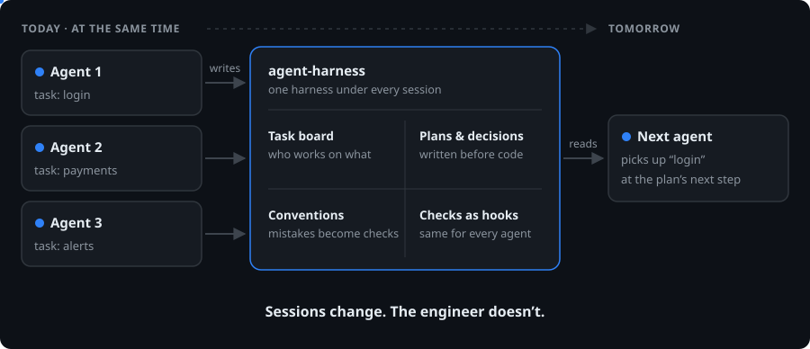

<div align="center">

# agent-harness

**Every AI session picks up where the last one left off — as if one engineer did all the work.**

Plans, decisions, conventions and lessons stay in the repo, and hooks keep every session working from them —
Claude Code or Codex, today's session or next month's.

agent-harness v1.1.0 · Claude Code · Codex

[English](README.md) · [한국어](README.ko.md)



</div>

## What carries over between sessions (template)

| | Without | With agent-harness |
|:--|:--|:--|
| A new session starts | You explain the project again | It gets the open tasks, reads their plans and continues from the next step |
| Yesterday's decisions | Gone with the chat | Kept in the plan. Rejected ideas are recorded so they are not proposed again |
| Conventions | Each session invents its own | One registry. A renamed copy of an existing function is caught |
| A mistake | Happens again next week | Written up as a lesson, and turned into a check when it can be |
| Several sessions at once | They overwrite each other | One worktree per task. A shared board shows who has what |
| Claude Code and Codex | Follow different rules | Read the same rules and run the same checks |
| "Done" | A claim | The full check has to pass before the work merges |

<details>
<summary><b>Two ways to install — the full template or the checks-only plugin</b></summary>

| | Template — the full harness | Plugin — the checks only |
|:--|:--|:--|
| How | Clone into a new project | Two commands in Claude Code, on any existing repo |
| Open tasks, plans, decisions and lessons carried to the next session | ✓ | — |
| Checks on save, at session end, before push | ✓ | ✓ |
| Blocks writing source files through the shell | ✓ | ✓ |
| Plan before code: scope → research → plan → your approval | ✓ | — |
| One worktree per task and a shared task board | ✓ | — |
| GitHub remote | optional — without one, finished work merges locally | — |
| Codex support | ✓ | — |
| Lessons become gates, the harness map stays in sync, maintenance reminders | ✓ | — |
| Update | `python -X utf8 harness_install.py --upgrade` | `/plugin update agent-harness@agent-harness` |

</details>

## Quick start — template

```bash
git clone https://github.com/Gruci/agent-harness.git my-project
cd my-project
python -X utf8 harness_install.py --new
```

The three lines are the same in PowerShell, cmd and bash. Use `python3` where `python` is missing (macOS, Linux). `--new` gives the folder its own git history and first commit; if git does not know your name and email yet, it shows the two commands to run and changes nothing.

You need Python 3.10+ and git. GitHub is optional — the setup asks once, and you can stay local.

> **Permissions.** Inside this folder Claude Code runs without approval prompts (`.claude/settings.json` sets `bypassPermissions`); the hooks stop irreversible commands such as wiping the main folder or force-pushing the main branch. `setup_global_permissions.py` turns prompts off for **every project on this computer** — run it only if you want that.

Open Claude Code in the folder and say:

```
set up the harness
```

It asks what you want to build — no technical terms needed. If the language or framework isn't decided, it explains what changes with each option and you choose. It creates the settings file, prepares checks for the stack you chose and connects GitHub. Then just ask for work:

```
add a login feature
```

## Quick start — plugin

```
/plugin marketplace add Gruci/agent-harness
/plugin install agent-harness@agent-harness
```

Then, in a repo you want checked, say `set up the harness`. Only the settings file (`harness_profile.py`) and a few check records are added to your project, and repos you don't connect are left alone.

## How a change flows (template)

```
[questions] → [research] → [plan] → [approval] → [build + checks] → [pre-merge check] → [merge]
                                        ▲
                                  where you answer
```

- It asks about scope first, then waits for you to approve the plan. Screen work adds a mockup you approve. Setup asks what you are building and starts all code as one part; it proposes splitting when a second area appears.
- Small fixes to existing files skip the planning step. Their size is measured when the work is merged (up to 3 files and 40 changed lines, no new files); a fix that grew goes back to a plan.
- The plan names the files to change and includes real code. Blanks like "implement later" make it invalid.
- Building happens in a separate work copy (worktree) for each task. The main folder holds only plans and the work board.
- Every save runs the checks and reports violations; the AI fixes them right away. Inside a work copy they are reported, not blocked.
- Merging into the main copy or pushing reruns every check first. Nothing is merged while violations remain.
- Screen work starts with a mockup file you approve, and the build follows it exactly.

## What it catches

The rules every session works under. When one is broken the session hears about it right away, and the work cannot merge until it is fixed.

<p align="center"></p>
<p align="center"><sub>A recorded session with the plugin. The agent tries to write a file through the shell and is refused, writes a 520-line file and hits the 400-line limit, then stops instead of working around the gate. The grey lines are notes added for this README.</sub></p>

A few examples. How the pieces fit together and what the terms mean is in the [overview](dev/OVERVIEW.md) (Korean); the full list of checks is in the [harness map](dev/HARNESS.md).

| Caught | Why |
|:--|:--|
| New code with no assigned component | Decide where it belongs first so the structure holds |
| Hard-coded colors in screen code | Colors live in one place |
| Fixed pixel widths | They break phone screens |
| Files over 400 lines, functions over 80 | One file, one function, one job |
| API keys in source | Move them to settings; rotate if already pushed |
| Docs pointing at files that don't exist | Leftovers from a rename |
| An existing function rebuilt under a new name, or copied with its variables renamed | One job, one place |
| A second HTTP client, database connection or date formatter | One module owns each shared capability |
| Mixed naming — camelCase functions or response keys in a snake_case project, `get_` and `fetch_` for the same data | Names follow one style |
| A route that returns its own error or response shape | Every response goes through one wrapper |
| An API with no screen that uses it | Users can't see it |
| Force-pushing over the main branch, wiping the main folder, deleting outside the project | It can't be undone. The AI stops and leaves it to you |

<details>
<summary><b>Reading check results — what [OK], [FAIL], [SKIP] and the other marks mean</b></summary>

| Mark | Meaning | What to do |
|:--|:--|:--|
| `[OK]` | Checked, no problems | Nothing |
| `[FAIL]` | Rule broken | Fix it. It won't be merged into the main copy until fixed |
| `[WIP]` | A violation inside a work copy | Fix it before merging. It doesn't block while you work |
| `[SKIP]` | Settings empty, so it didn't run | Fill in the setting. Not a pass |
| `[N/A]` | Doesn't apply to this kind of project | Nothing |
| `[TOOL]` | A required tool is missing | Install it. Not counted as done |
| `[DECISION]` | A new classification needs your decision | Answer the proposal |
| `[REPORT]` | An uncertain signal | Take a look |

Guesses never block. For example, "this work copy looks finished" is only a warning; you can still end the session.

</details>

## FAQ

**Can I install it before choosing a stack?**
Yes. No language is assumed; you decide together before the first line of code.

**Which languages does it check?**
The harness itself runs on Python; your product can be in any language. Python, Go, TypeScript and Java checks are built in (`kernel/langs/`), along with one server and one screen framework pack (`kernel/frameworks/`). Reading the code needs no installs; each language's own linter (ruff, go vet and staticcheck, tsc) is suggested at setup and installed only if you agree — `--doctor` lists what is missing. If you decline, setup removes that linter from the settings so work can still be finished; the AI tells you which rules that leaves unchecked. For another language, setup ports the harness by writing one short language file — a few regular expressions for functions, imports and top-level names, plus the import rule and standard library — and `python -X utf8 -m kernel.pack_check <name>` proves the checks really turn on. Checks that only mean something in one language are declared `[N/A]`; a check that cannot run shows `[TOOL]` and never counts as passing. Setup also binds the component graph to the language you chose (`python -X utf8 -m kernel.graph_workflow bind`), so files in that language are classified instead of ignored.

**My service has no screens, but screen checks keep showing `[SKIP]`.**
Put `ARCH = "backend_only"` (server only) or `ARCH = "headless"` (no web, no screens) in `harness_profile.py`. They become `[N/A]`. If you do have screens and screen checks show `[SKIP]`, list your framework pack names (file names in `kernel/frameworks/`) in `FRAMEWORK`.

**Do I need GitHub?**
No. Without a remote, finished work is merged on your computer only, and the harness reminds you that nothing is backed up. When you want one, it shows the signed-in `gh` account and asks before creating a private repository, or takes an address you give it.

**I changed my mind about a task.**
Ask the AI to drop it. `python -X utf8 -m kernel.task abandon` removes the task's work copy and branch. It refuses while there is unsaved work, and while there are commits not yet merged unless you agree to lose them (`--discard-commits`). Its research and plan notes stay in `docs/tasks/`; delete them if you will not reuse them.

**How do I update the harness?**
For the plugin, `/plugin update agent-harness@agent-harness`. For the template, `python -X utf8 harness_install.py --check-update` tells you whether a new version exists; commit your changes and run `--upgrade`. It judges each harness-owned file by upstream history: upstream changes and deletions are applied, files you added are left alone, and a file you changed stops the upgrade with a draft issue so the fix can go upstream (`--keep-local` keeps your version and upgrades the rest). Your settings, hooks wiring and docs stay; wiring that differs from upstream is reported, not changed.

**Is there an architecture diagram tool?**
Not included. If you need one, install it separately.

## Details

You don't need these to get started — the AI handles them.

<details>
<summary><b>Using it with Codex</b></summary>

Claude Code and Codex share the rules, the working steps and the check engine. The shared steps are in the [workflow index](dev/workflows/README.md).

```bash
python -X utf8 setup_global_permissions.py --agent both   # set up both tools at once
python -X utf8 harness_install.py --check-agents          # check the wiring
```

For the Codex side, Python 3.11+ is recommended (3.10 needs the `toml` package). Changes apply from the next session, and host policies such as company settings take precedence.

</details>

<details>
<summary><b>Work happens in work copies</b></summary>

- One session or many, every task gets its own work copy at `worktrees/<task scope>--<session tag>`, so the list shows who is doing what.
- Starting a task registers it on the work board (`workboard/`). Editing code without registering is blocked.
- Touching a scope another session has claimed shows a warning.
- While a work copy exists, commits and branch switches in the main folder are blocked. Merge a finished branch with `git merge --ff-only <branch>`.
- Every check runs in that folder right before push, PR or merge, and nothing goes out until it passes.

</details>

<details>
<summary><b>Manual install</b></summary>

```bash
python -X utf8 harness_install.py --doctor            # check the environment; exit 1 if something would block
python -X utf8 harness_install.py                     # create settings and verify
python -X utf8 setup_global_permissions.py            # optional: turns approval prompts off for EVERY project on this computer
```

You need a Git repository and Python 3.10+ (as `python` or `python3`). Screen checks need Node.js and ESLint in the screen folder; Go can use tree-sitter when it is installed. `--doctor` lists anything missing and says which items block.

For a project that already has code, run `--dry-run` first to see current violations.

</details>

## Changelog

| Version | Changes |
|:--|:--|
| **v1.1.0** | Built-in Go, TypeScript and Java checks with no installs, and a short language file to port to any other language. Catches renamed copies, second HTTP clients and date formatters, mixed naming, and per-route response shapes. One-line install in any shell, local-only finish without GitHub, small fixes without a plan, `abandon`, a blocking `--doctor`. Template installs: after `--upgrade`, copy the hook commands from upstream `.claude/settings.json` (they now find `python3` too) — wiring is reported, not changed. New checks may flag existing code: fix it or list it in `harness_baseline.txt`. |
| **v1.0.0** | First public release. |

## License

Daehyun Kim · [LinkedIn](https://www.linkedin.com/in/daehyun-kim-b00365176/)

MIT License
