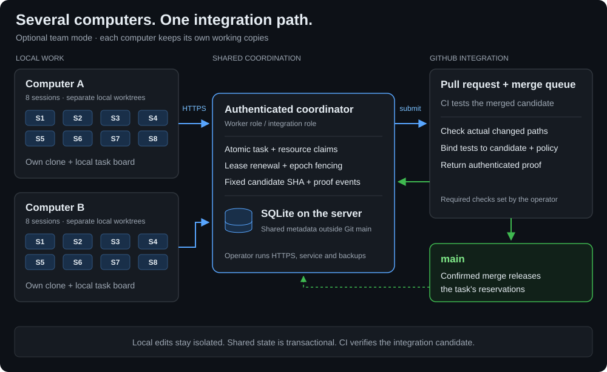

<div align="center">

# dev-harness

**A development harness for Claude Code and Codex.**

Plans, decisions, conventions and lessons stay in the repo, and hooks keep every session working from them —
whichever agent, today's session or next month's.

dev-harness v1.3.1 · shared project context, isolated tasks, enforced checks

[English](README.md) · [한국어](README.ko.md)


</div>

## What carries over between sessions (template)

| | Without | With dev-harness |
|:--|:--|:--|
| A new session starts | You explain the project again | It gets the open tasks, reads their plans and continues from the next step |
| Yesterday's decisions | Gone with the chat | Kept in the plan. Rejected ideas are recorded so they are not proposed again |
| Conventions | Each session invents its own | One registry. A renamed copy of an existing function is caught |
| A mistake | Happens again next week | Written up as a lesson, and turned into a check when it can be |
| Several sessions at once | They overwrite each other | One worktree per task. A shared board shows who has what |
| Different agents | Follow different rules | Read the same rules and run the same checks |
| "Done" | A claim | The full check and your tests have to pass before the work merges |

## Install

| | Template — the full harness | Plugin — the checks only |
|:--|:--|:--|
| How | Clone into a new project | Two commands in Claude Code, on any existing repo |
| Open tasks, plans, decisions and lessons carried to the next session | ✓ | — |
| Checks on save, at session end, before push | ✓ | ✓ |
| Blocks writing source files through the shell | ✓ | ✓ |
| Plan before code: scope → research → plan → your approval | ✓ | — |
| One worktree per task, a shared task board, product tests before merge | ✓ | — |
| Coordination across computers through an authenticated service | optional | — |
| Codex support | ✓ | — |
| Update | `python -X utf8 harness_install.py --upgrade` | `/plugin update dev-harness@dev-harness` |

**Template.** Needs Python 3.10+ and git; GitHub is optional. Same in PowerShell, cmd and bash (`python3` on macOS and Linux).

```bash
git clone https://github.com/Gruci/dev-harness.git my-project
cd my-project
python -X utf8 harness_install.py --new
```

**Plugin.** Only a settings file and a few check records are added; other repos are left alone.

```
/plugin marketplace add Gruci/dev-harness
/plugin install dev-harness@dev-harness
```

Already installed under the previous name? Follow the [plugin migration steps](dev/harness/operations.md#플러그인-이름-변경).

Then open Claude Code in the folder and say `set up the harness`. It asks what you want to build, helps you pick a stack, and turns on the checks that fit it.

> **Permissions.** Inside this folder Claude Code runs without approval prompts; hooks still stop irreversible commands and shell writes to source files. `setup_global_permissions.py` turns prompts off for **every project on this computer** — run it only if you want that.

> **A repo that already has code.** Run `python -X utf8 harness_install.py --dry-run` first. Install reports existing violations; it does not hide them. You fix them, or a person freezes known ones in `harness_baseline.txt`.

## Your first task

Just ask for work — `add a login feature`. The change then goes through:

```
[questions] → [research] → [plan] → [approval] → [build + checks] → [pre-merge check + product tests] → [merge]
                                        ▲
                                  where you answer
```

- You answer twice: the scope questions and the plan approval. Screen work adds a mockup to approve.
- Small fixes (up to 3 existing files, 40 lines) skip the plan. A save warns at 80% of that limit, and finish refuses a fix that grew.
- Each task is built in its own worktree. The main folder holds only plans and the task board.
- Every save runs the checks; inside a worktree they only report, and the AI fixes them before merging.
- Work merges only after the full check — and your declared tests — pass on the same commit.

## What "done" guarantees — and what it does not

| Guaranteed | How |
|:--|:--|
| Nothing merges with a failed check | Finish and the pre-push hook run the full check and refuse anything but a pass |
| Your tests ran on the merged commit | Tests declared in `TESTS` run at finish and in CI; zero tests or a missing report counts as a failure |
| A check you mark as cannot-skip really ran | A check listed in `REQUIRED_CHECKS` blocks the merge if it did not run (once setup is done) |
| Another session's worktree is left alone | Editing it is blocked, even one line, until the task is handed over |
| A mistake becomes a rule | Every lesson names its check, or says why it cannot have one |

| Not guaranteed | What to know |
|:--|:--|
| Tests you did not declare | Without `TESTS`, a green finish means "checks passed", not "tests passed" |
| Tests on a hand-typed `git push` | The pre-push hook runs the full check only; tests run at finish and in CI |
| Every `[SKIP]` | `[SKIP]` is not a pass, but only cannot-skip checks block the merge |
| Files outside a task's scope | Finish lists them as `[TOUCH]` and still merges, unless the main folder sets `TOUCH_ENFORCE = True` |
| Separate databases, ports or caches per task | Not provided; parallel tasks share them |
| A security boundary | Hooks keep a cooperating agent on the rules; they are not a sandbox |
| Correct business logic | Whether the tests cover the right behavior is still a review |

## What it catches

The rules every session works under. When one is broken the session hears about it right away, and the work cannot merge until it is fixed.

<p align="center"></p>
<p align="center"><sub>A recorded session with the plugin. The agent tries to write a file through the shell and is refused, writes a 520-line file and hits the 400-line limit, then stops instead of working around the gate. The grey lines are notes added for this README.</sub></p>

A few examples. How the pieces fit together and what the terms mean is in the [overview](dev/OVERVIEW.md) (Korean); the full list of checks is in the [harness map](dev/HARNESS.md).

| Caught | Why |
|:--|:--|
| New code with no assigned component | Decide where it belongs first so the structure holds |
| Hard-coded colors in screen code, fixed pixel widths | Colors live in one place; fixed widths break phone screens |
| Files over 400 lines, functions over 80 | One file, one function, one job |
| API keys in source | Move them to settings; rotate if already pushed |
| Docs pointing at files that don't exist | Leftovers from a rename |
| An existing function rebuilt under a new name, or copied with its variables renamed | One job, one place |
| A second HTTP client, database connection or date formatter | One module owns each shared capability |
| Mixed naming — camelCase in a snake_case project, `get_` and `fetch_` for the same data | Names follow one style |
| An API with no screen that uses it | Users can't see it |
| A shared rule missing from the Claude or the Codex instructions | Both agents follow the same rules |
| Force-pushing over the main branch, wiping the main folder, deleting outside the project | It can't be undone. The AI stops and leaves it to you |

<details>
<summary><b>Reading check results — what [OK], [FAIL], [SKIP] and the other marks mean</b></summary>

| Mark | Meaning | What to do |
|:--|:--|:--|
| `[OK]` | Checked, no problems | Nothing |
| `[FAIL]` | Rule broken | Fix it. It won't be merged until fixed |
| `[WIP]` | A violation inside a worktree | Fix it before merging. It doesn't block while you work |
| `[SKIP]` | Settings empty, so it didn't run | Fill in the setting. Not a pass |
| `[N/A]` | Doesn't apply to this kind of project | Nothing |
| `[TOOL]` | A required tool is missing | Install it. Not counted as done |
| `[DECISION]` | A new classification needs your decision | Answer the proposal |
| `[REPORT]` | An uncertain signal, such as a doc too large to read in one pass | Take a look |

Guesses never block. For example, "this worktree looks finished" is only a warning; you can still end the session.

</details>

## Several computers — optional team mode

<p align="center"></p>

Each computer keeps its own clone, worktrees and local task board.
Team mode adds a coordinator for shared task ownership, file and contract reservations, and lease generations; its state stays in the coordinator's SQLite database, outside your project's Git history.
After deploying the coordinator, set `harness_profile.py`:

```python
MERGE_FLOW = "pr"
TEAM = {
    "url": "https://harness.example.com",
    "repository": "owner/repository",
    "token_env": "HARNESS_WORKER_TOKEN",
}
```

The operator runs the service with its database and configuration outside the repository, behind HTTPS, and sets up persistence, backups, GitHub's required checks and the merge queue — the harness does not create those protections:

```bash
python -X utf8 -m kernel.team serve --database /srv/harness/team.sqlite --config /srv/harness/team.json
```

Workers claim their scope and resources, renew their leases, and submit an immutable commit. CI checks the actual changed paths and the merged result; an authenticated merge confirmation releases the reservations.
With `TEAM = {}`, the local workflow is unchanged. See [team setup and operations](dev/TEAM.md) for tokens, roles, task dependencies and CI wiring.

## FAQ

| Question | Answer |
|:--|:--|
| Can I install before choosing a stack? | Yes. You pick it together before the first line of code. |
| Which languages are checked? | Python, Go, TypeScript and Java out of the box. Setup ports any other language with one short file. |
| No screens, but screen checks show `[SKIP]` | Set `ARCH = "backend_only"` or `"headless"` in `harness_profile.py`. |
| How do I make the harness run my tests? | Declare them in `TESTS` with a JUnit report slot, e.g. `{"slug": "pytest", "cmd": ("python", "-m", "pytest", "-q", "--junitxml={report}")}`. Add `"tests"` to `REQUIRED_CHECKS` so a missing declaration blocks the merge. |
| Do I need GitHub? | Optional for solo work; without a remote, work merges on your computer. Team mode uses GitHub PRs and CI. |
| How do I drop a task? | Ask the AI. Unsaved or unmerged work is never deleted without your OK. |
| How do I update? | Plugin: `/plugin update dev-harness@dev-harness`. Template: `python -X utf8 harness_install.py --upgrade`. |

## Details

You don't need these to get started — the AI handles them.

<details>
<summary><b>Using it with Codex</b></summary>

Claude Code and Codex share the rules, the working steps and the check engine. The shared steps are in the [workflow index](dev/workflows/README.md), and a check flags a shared rule missing from either agent's instructions.

```bash
python -X utf8 setup_global_permissions.py --agent both   # set up both tools at once
python -X utf8 harness_install.py --check-agents          # check the wiring
```

For the Codex side, Python 3.11+ is recommended (3.10 needs the `toml` package). Changes apply from the next session, and host policies such as company settings take precedence.

</details>

<details>
<summary><b>Work happens in worktrees</b></summary>

- One session or many, every task gets its own worktree at `worktrees/<task scope>--<session tag>`, so the list shows who is doing what.
- Starting a task registers it on the task board (`workboard/`). Editing code without registering is blocked.
- Touching a scope another session has claimed shows a warning; editing inside another session's worktree is blocked.
- While a worktree exists, commits and branch switches in the main folder are blocked. Merge a finished branch with `git merge --ff-only <branch>`.
- Every check runs in that folder right before push, PR or merge, and nothing goes out until it passes.

</details>

<details>
<summary><b>Manual install</b></summary>

```bash
python -X utf8 harness_install.py --doctor            # check the environment; exit 1 if something would block
python -X utf8 harness_install.py                     # create settings and verify
python -X utf8 setup_global_permissions.py            # optional: turns approval prompts off for EVERY project on this computer
```

You need a Git repository and Python 3.10+ (as `python` or `python3`). Screen checks need Node.js and ESLint in the screen folder; Go can use tree-sitter when it is installed. `--doctor` lists anything missing and says which items block.

</details>

## Changelog

| Version | Changes |
|:--|:--|
| **v1.3.1** | Renamed to dev-harness, with the previous upstream address still recognized. |
| **v1.3.0** | Product tests before every merge, checks that cannot be skipped, and stricter worktree isolation. |
| **v1.2.0** | Optional authenticated team coordinator, shared resource reservations and CI verification of PR and merge queue candidates. |
| **v1.1.0** | Broader language support. |
| **v1.0.0** | First public release. |

## License

Daehyun Kim · [LinkedIn](https://www.linkedin.com/in/daehyun-kim-b00365176/)

MIT License
